# Esquema de la base de datos

Diagrama entidad-relación de la base (PostgreSQL / Supabase). Fuente de verdad: [`init_db.sql`](init_db.sql).

```mermaid
erDiagram
    roles {
        bigint   id          PK "identity"
        varchar  codigo      UK "super_admin | admin | usuario"
        varchar  nombre         "NOT NULL (50)"
        varchar  descripcion    "nullable (200)"
    }

    permisos {
        bigint   id          PK "identity"
        varchar  codigo      UK "recurso.accion (80)"
        varchar  descripcion    "nullable (200)"
    }

    roles_permisos {
        bigint   rol_id      FK "PK -> roles.id (ON DELETE CASCADE)"
        bigint   permiso_id  FK "PK -> permisos.id (ON DELETE CASCADE)"
    }

    docentes {
        bigint      id            PK "identity"
        varchar     nombre           "NOT NULL (100)"
        varchar     apellido         "NOT NULL (100)"
        varchar     email         UK "NOT NULL (150) - login"
        varchar     rol              "NOT NULL (20) - cargo: Profesor|Ayudante|Colaborador"
        varchar     foto             "nullable (255) - path en el bucket"
        varchar     password_hash    "NOT NULL (255) - bcrypt"
        boolean     activo           "NOT NULL default true"
        timestamptz created_at       "NOT NULL default now()"
        timestamptz updated_at       "nullable - null al crear; la API lo setea al actualizar"
    }

    estudiantes {
        bigint      id            PK "identity"
        varchar     padron        UK "NOT NULL (20)"
        varchar     nombre           "NOT NULL (100)"
        varchar     apellido         "NOT NULL (100)"
        varchar     email         UK "NOT NULL (150) - login"
        varchar     password_hash    "NOT NULL (255) - bcrypt"
        boolean     activo           "NOT NULL default true"
        timestamptz created_at       "NOT NULL default now()"
        timestamptz updated_at       "nullable - null al crear; la API lo setea al actualizar"
    }

    docentes_permisos {
        bigint   docente_id    FK "PK -> docentes.id (ON DELETE CASCADE)"
        bigint   permiso_id    FK "PK -> permisos.id (ON DELETE CASCADE)"
        boolean  concedido        "NOT NULL (true=otorga, false=revoca)"
    }

    estudiantes_permisos {
        bigint   estudiante_id FK "PK -> estudiantes.id (ON DELETE CASCADE)"
        bigint   permiso_id    FK "PK -> permisos.id (ON DELETE CASCADE)"
        boolean  concedido        "NOT NULL (true=otorga, false=revoca)"
    }

    materias {
        bigint   id          PK "identity"
        varchar  codigo      UK "NOT NULL (20)"
        varchar  nombre         "NOT NULL (150)"
        varchar  descripcion    "nullable (500)"
    }

    cursadas {
        bigint      id           PK "identity"
        bigint      materia_id   FK "-> materias.id (ON DELETE CASCADE)"
        smallint    anio            "NOT NULL"
        smallint    cuatrimestre    "NOT NULL (1|2)"
        date        fecha_inicio    "NOT NULL"
        date        fecha_fin       "NOT NULL"
        timestamptz created_at      "NOT NULL default now()"
        timestamptz updated_at      "nullable (la API)"
    }

    inscripciones {
        bigint      id            PK "identity"
        bigint      cursada_id    FK "-> cursadas.id (ON DELETE CASCADE)"
        bigint      estudiante_id FK "-> estudiantes.id (ON DELETE CASCADE)"
        boolean     recursa          "NOT NULL default false"
        varchar     estado           "cursando | abandono | baja (default cursando)"
        varchar     motivo_baja      "nullable - razon de la baja"
        timestamptz created_at       "NOT NULL default now()"
        timestamptz updated_at       "nullable (la API)"
    }

    cursada_docentes {
        bigint      cursada_id FK "PK -> cursadas.id (ON DELETE CASCADE)"
        bigint      docente_id FK "PK -> docentes.id (ON DELETE CASCADE)"
    }

    evaluaciones {
        bigint      id          PK "identity"
        bigint      cursada_id  FK "-> cursadas.id (ON DELETE CASCADE)"
        varchar     nombre         "NOT NULL (150)"
        varchar     descripcion    "nullable (500)"
        varchar     tipo           "obligatorio | opcional"
        varchar     criterio       "nota | aprobado_desaprobado | entregado_no_entregado"
        numeric     peso           "NOT NULL default 0 (promedio)"
        varchar     modalidad      "grupal | individual"
        varchar     visibilidad    "habilitado | deshabilitado | sin_entrega"
        boolean     requiere_corrector "NOT NULL default true - false: sin correccion docente"
        boolean     permite_crear_grupos "NOT NULL default false - 1 sola activa por cursada"
        timestamptz created_at     "NOT NULL default now()"
        timestamptz updated_at     "nullable (la API)"
    }

    evaluacion_instancias {
        bigint      id            PK "identity"
        bigint      evaluacion_id FK "-> evaluaciones.id (ON DELETE CASCADE)"
        smallint    numero           "NOT NULL (unico por evaluacion)"
        varchar     nombre           "NOT NULL (80) - '1er parcial', 'Recuperatorio', 'Entrega'"
        date        fecha            "nullable - cuando se rinde/entrega"
        varchar     estado           "abierta | cerrada (default abierta)"
        timestamptz created_at       "NOT NULL default now()"
        timestamptz updated_at       "nullable (la API)"
    }

    grupos {
        bigint      id            PK "identity"
        bigint      evaluacion_id FK "-> evaluaciones.id (ON DELETE CASCADE)"
        smallint    numero           "NOT NULL (unico por evaluacion)"
        varchar     nombre           "NOT NULL (150)"
        bigint      owner_id      FK "-> estudiantes.id (creador)"
        bigint      tutor_id      FK "-> docentes.id (nullable)"
        timestamptz created_at       "NOT NULL default now()"
        timestamptz updated_at       "nullable (la API)"
    }

    grupo_estudiantes {
        bigint   grupo_id      FK "PK -> grupos.id (ON DELETE CASCADE)"
        bigint   estudiante_id FK "PK -> estudiantes.id (ON DELETE CASCADE)"
    }

    notas {
        bigint      id            PK "identity"
        bigint      instancia_id  FK "-> evaluacion_instancias.id (ON DELETE CASCADE)"
        bigint      estudiante_id FK "-> estudiantes.id (ON DELETE CASCADE)"
        numeric     nota             "nullable (criterio=nota)"
        varchar     estado           "nullable (aprobado/entregado/...)"
        varchar     observaciones    "nullable (500) - devolucion del corrector"
        bigint      corrector_id  FK "-> docentes.id (nullable: pendiente o no aplica)"
        timestamptz corregido_at     "nullable - cuando se corrigio"
        timestamptz created_at       "NOT NULL default now()"
        timestamptz updated_at       "nullable (la API)"
    }

    notas_grupo {
        bigint      id          PK "identity"
        bigint      instancia_id FK "-> evaluacion_instancias.id (ON DELETE CASCADE)"
        bigint      grupo_id    FK "-> grupos.id (ON DELETE CASCADE)"
        numeric     nota          "nullable (criterio=nota)"
        varchar     estado        "nullable"
        varchar     observaciones "nullable (500) - devolucion del corrector"
        bigint      corrector_id FK "-> docentes.id (nullable: pendiente o no aplica)"
        timestamptz corregido_at  "nullable - cuando se corrigio"
        timestamptz created_at    "NOT NULL default now()"
        timestamptz updated_at    "nullable (la API)"
    }

    clases {
        bigint      id         PK "identity"
        bigint      cursada_id FK "-> cursadas.id (ON DELETE CASCADE)"
        date        fecha         "NOT NULL"
        varchar     titulo        "nullable (150)"
        varchar     estado        "abierta | cerrada (default abierta)"
        timestamptz created_at    "NOT NULL default now()"
        timestamptz updated_at    "nullable (la API)"
    }

    asistencias {
        bigint      id             PK "identity"
        bigint      clase_id       FK "-> clases.id (ON DELETE CASCADE)"
        bigint      estudiante_id  FK "-> estudiantes.id (ON DELETE CASCADE)"
        varchar     codigo            "NOT NULL (16) - QR + fallback tipeable; unico por clase"
        varchar     estado            "pendiente | presente | ausente (default pendiente)"
        varchar     metodo            "nullable - qr | manual | padron"
        bigint      marcado_por    FK "-> docentes.id (nullable)"
        timestamptz marcado_at        "nullable"
        boolean     enviado           "NOT NULL default false"
        timestamptz enviado_at        "nullable"
        smallint    envio_intentos    "NOT NULL default 0"
        varchar     envio_error       "nullable (300)"
        timestamptz created_at        "NOT NULL default now()"
        timestamptz updated_at        "nullable (la API)"
    }

    roles       ||--o{ roles_permisos       : "tiene"
    permisos    ||--o{ roles_permisos       : "en"
    docentes    ||--o{ docentes_permisos    : "override"
    permisos    ||--o{ docentes_permisos    : "de"
    estudiantes ||--o{ estudiantes_permisos : "override"
    permisos    ||--o{ estudiantes_permisos : "de"

    materias    ||--o{ cursadas          : "se dicta en"
    cursadas    ||--o{ inscripciones     : "tiene"
    estudiantes ||--o{ inscripciones     : "cursa"
    cursadas    ||--o{ cursada_docentes  : "plantel"
    docentes    ||--o{ cursada_docentes  : "dicta"
    cursadas    ||--o{ evaluaciones      : "define"
    evaluaciones||--o{ grupos            : "arma (si es grupal)"
    estudiantes ||--o{ grupos            : "owner"
    docentes    ||--o{ grupos            : "tutoriza"
    grupos      ||--o{ grupo_estudiantes : "integra"
    estudiantes ||--o{ grupo_estudiantes : "miembro"
    evaluaciones||--o{ evaluacion_instancias : "se rinde en"
    evaluacion_instancias ||--o{ notas   : "nota individual"
    estudiantes ||--o{ notas             : "recibe"
    evaluacion_instancias ||--o{ notas_grupo : "nota de grupo"
    grupos      ||--o{ notas_grupo       : "recibe"
    cursadas    ||--o{ clases            : "toma asistencia en"
    clases      ||--o{ asistencias       : "registra"
    estudiantes ||--o{ asistencias       : "asiste"
    docentes    ||--o{ asistencias       : "marca"

    registros {
        bigint      id           PK "identity"
        varchar     actor_tipo      "NOT NULL (20) - docente | estudiante"
        bigint      actor_id        "NOT NULL - sin FK: el actor puede darse de baja"
        varchar     actor_email     "NOT NULL (255) - snapshot del email"
        varchar     accion          "NOT NULL (60) - codigo estable recurso.accion"
        varchar     descripcion     "NOT NULL (300) - texto listo para mostrar"
        jsonb       detalle         "NOT NULL default '{}' - ids y antes/despues"
        bigint      cursada_id   FK "-> cursadas.id (ON DELETE SET NULL, nullable)"
        timestamptz created_at      "NOT NULL default now()"
    }

    cursadas    ||--o{ registros         : "contexto"
```

## Notas

- **RBAC con rol derivado.** El rol de seguridad de una persona no se guarda como FK: se **deriva**.
  - `docentes`: el `rol` (cargo) determina el rol RBAC → `Profesor` = `super_admin`;
    `Ayudante` / `Colaborador` = `admin` (ver `CARGO_A_ROL` en `constants.py`).
  - `estudiantes`: siempre `usuario`.
- **`roles` / `permisos` / `roles_permisos`** definen, a nivel general y configurable, qué permisos
  tiene cada rol. `roles_permisos` es la matriz rol→permiso.
- **Overrides por usuario** (`docentes_permisos`, `estudiantes_permisos`): excepciones individuales.
  `concedido = true` **otorga** un permiso extra; `concedido = false` **revoca** uno del rol.
  Permiso efectivo = permisos del rol ∪ otorgados − revocados.
- **Autenticación propia (monolito).** `docentes` y `estudiantes` guardan `password_hash` (bcrypt) y
  se autentican por `email` + password. No hay tabla de usuarios aparte.
- **Auditoría.** `created_at` / `updated_at` en `docentes` y `estudiantes`. `created_at` lo setea la
  API al crear (con `DEFAULT now()` como red de seguridad). `updated_at` queda **NULL al crear**
  (todavía no se actualizó) y la API lo setea en cada update. No hay trigger en la base.
- **Campos de valor fijo como `VARCHAR`** (no `ENUM`): validación en Python (`constants.py` +
  validators), por portabilidad.
  - `docentes.rol` ∈ `Profesor` | `Ayudante` | `Colaborador`
  - `roles.codigo` ∈ `super_admin` | `admin` | `usuario`
  - `permisos.codigo` con formato `recurso.accion` (ej. `docentes.gestionar`)
  - `inscripciones.estado` ∈ `cursando` | `abandono` | `baja`
  - `evaluaciones.tipo` ∈ `obligatorio` | `opcional`
  - `evaluaciones.criterio` ∈ `nota` | `aprobado_desaprobado` | `entregado_no_entregado`
  - `evaluaciones.modalidad` ∈ `grupal` | `individual`
  - `evaluaciones.visibilidad` ∈ `habilitado` | `deshabilitado` | `sin_entrega`
  - `clases.estado` ∈ `abierta` | `cerrada`
  - `asistencias.estado` ∈ `pendiente` | `presente` | `ausente`; `asistencias.metodo` ∈ `qr` | `manual` | `padron`
- **Seed**: `roles`, `permisos` y su matriz `roles_permisos`; docentes bootstrap (password
  `Prueba123#`) y el padrón de estudiantes de la cursada (password = su padrón); una `materia` y una
  `cursada` de ejemplo. Cambiar los passwords en el primer acceso.

## Registro de auditoría

- **`registros`**: una fila por cada acción relevante que hace un actor (todas las mutaciones del
  backoffice docente — CRUD de docentes/estudiantes/cursadas, permisos, equipos, disparo de toma,
  envío de QRs y cierre de asistencia — y, cuando existan, las acciones propias del estudiante
  como crear o renombrar su equipo). La escribe la API al final de cada mutación exitosa
  (`registro.registrar`, fail-open: si el insert falla, la operación de negocio sigue igual).
- **Foto inmutable**: `actor_email` y `descripcion` quedan congelados aunque el actor se edite o
  se dé de baja después; por eso `actor_id` no es FK. `detalle` (JSONB) guarda ids y metadatos
  antes/después que no se muestran en la tabla pero sirven para investigar.
- **Solo lectura**: se consulta con `GET /registros` (permiso `registros.leer`, filtrable por
  email del actor, `accion`, `tipo` docente/estudiante, `cursada` y ordenable por horario); no hay
  endpoints de escritura ni borrado — la auditoría no se modifica desde la API.
- **El marcado de asistencia no se registra**: generaría una fila por estudiante por clase (volumen
  alto, bajo valor); la marca ya queda trazada en `asistencias.marcado_por`/`marcado_at`.

## Dominio de cursada

- **Materia → cursadas**: una `materia` se dicta en varias `cursadas` (una por `anio` +
  `cuatrimestre`; único `(materia_id, anio, cuatrimestre)`, con `cuatrimestre` ∈ {1, 2}). Cada
  cursada tiene `fecha_inicio` y `fecha_fin`; la **cursada vigente** es aquella cuyo período incluye
  la fecha actual (se usa para inscribir al dar de alta estudiantes).
- **Alta y modificación de cursadas**: se exponen como `POST /cursadas` y `PUT /cursadas/{id}`. El
  body usa `codigo`/`nombre` de la materia (se crea la materia si no existe). Las fechas deben caer
  dentro del cuatrimestre y del año indicados. Solo el rol `super_admin` posee los permisos
  `cursadas.crear` y `cursadas.modificar`.
- **Inscripciones**: `cursada` ↔ `estudiante` (único por cursada) con `recursa` y `estado`
  (`cursando`/`abandono`/`baja`). En `baja` se completa `motivo_baja`. No se borra la fila: se cambia
  el estado (traza histórica).
- **Plantel**: `cursada_docentes` vincula docentes por cursada (pueden variar por cuatrimestre). El
  cargo del docente es global (`docentes.rol`), no por cursada.
- **Evaluaciones**: se definen por cursada (tipo, criterio, peso, modalidad, visibilidad). El
  **promedio** considera las de `criterio = 'nota'` según su `peso`.
- **Instancias de evaluación**: una evaluación se rinde en una o varias instancias
  (`evaluacion_instancias`, `numero` único por evaluación) — las fechas/convocatorias donde se
  rinde o entrega: un parcial o final puede tener varias (1ra fecha + recuperatorios), un TP una
  sola. Cada instancia lleva `nombre`, `fecha` y `estado` (`abierta`/`cerrada`; cerrada bloquea la
  carga de notas). Se gestionan con `GET/POST /evaluaciones/{id}/instancias` y
  `PUT /instancias/{id}` (`evaluaciones.leer` / `evaluaciones.gestionar`); el `numero` se asigna
  solo (siguiente dentro de la evaluación) y no hay borrado (la instancia puede tener notas).
- **Notas** (resultado polimórfico): `nota` (numérica, para `criterio = 'nota'`) o `estado`
  (`aprobado`/`desaprobado`, `entregado`/`no_entregado`). Cuelgan de la **instancia**, no de la
  evaluación: única por `(instancia, estudiante)`. Un alumno puede tener nota en varias instancias
  de la misma evaluación (re-rendir en el recuperatorio); **la nota que vale para la evaluación es
  la de la última instancia que rindió** (la de mayor `numero` con nota del alumno).
- **Corrección**: `corrector_id` + `corregido_at` en `notas` y `notas_grupo` registran qué docente
  corrigió y cuándo (alimenta la columna "Corrector" del listado y los gráficos de % corregido por
  docente); `observaciones` es la devolución. `evaluaciones.requiere_corrector` (default `true`)
  indica si la evaluación precisa corrección docente: en `false` la nota queda sin corrector y la
  evaluación queda fuera de las métricas de correcciones. Semántica: `corrector_id IS NULL` +
  `requiere_corrector` → pendiente de corrección; `corrector_id IS NULL` + `NOT requiere_corrector`
  → no aplica.
- **Creación de equipos por alumnos**: `evaluaciones.permite_crear_grupos` (default `false`)
  abre/cierra la posibilidad de que los estudiantes creen equipos en una evaluación grupal.
  Solo **una** evaluación por cursada puede tenerla abierta — lo garantiza el índice parcial
  `UNIQUE (cursada_id) WHERE permite_crear_grupos` — y el toggle `PUT /evaluaciones/{id}/crear-grupos`
  exige `grupos.habilitar`, permiso exclusivo de `super_admin`.
- **Grupos por evaluación** (para `modalidad = 'grupal'`): `grupos` cuelga de `evaluaciones`
  (`numero` único por evaluación), con `owner` (estudiante creador, obligatorio) y `tutor` (docente,
  opcional). Los miembros están en `grupo_estudiantes`. La nota de grupo es una por instancia y
  grupo (`notas_grupo`, `UNIQUE(instancia_id, grupo_id)`). En una evaluación grupal, el estudiante
  tiene su **nota individual** (`notas`) **y** la **nota de su grupo** (`notas_grupo`).
- **Un grupo por estudiante por evaluación**: se valida en el service (no hay constraint en la base).
- **Baja lógica de estudiante**: el DELETE de estudiante es una baja lógica (`estudiantes.activo =
  false`); es distinta de la baja por cursada (`inscripciones.estado = 'baja'`).

## Dominio de asistencia

- **Clase**: una fecha de una cursada donde se toma asistencia (no todas las clases). Única por
  `(cursada_id, fecha)`; su `fecha` debe caer dentro de `fecha_inicio..fecha_fin` de la cursada.
  `estado` `abierta` mientras se marca; al **cerrar**, los `pendiente` pasan a `ausente`.
- **Asistencia**: una fila por `(clase, estudiante)` (única) para cada estudiante inscripto y activo
  al momento de disparar la toma. El `codigo` (corto, legible, sin caracteres ambiguos, único por
  clase) es el payload del **QR** y el **fallback tipeable**. Se marca `presente` por QR, por código
  tipeado (`manual`) o por `padron`; se guarda `metodo`, `marcado_por` (docente) y `marcado_at`.
  El email de confirmación de asistencia se envía solo la primera vez que pasa a `presente`.
- **Envío de QRs reanudable**: el estado del email vive en la fila (`enviado`, `enviado_at`,
  `envio_intentos`, `envio_error`). El envío se hace por lotes (los `enviado = false`), de modo que
  una caída de conexión se resuelve reintentando la misma llamada (idempotente, at-least-once).
